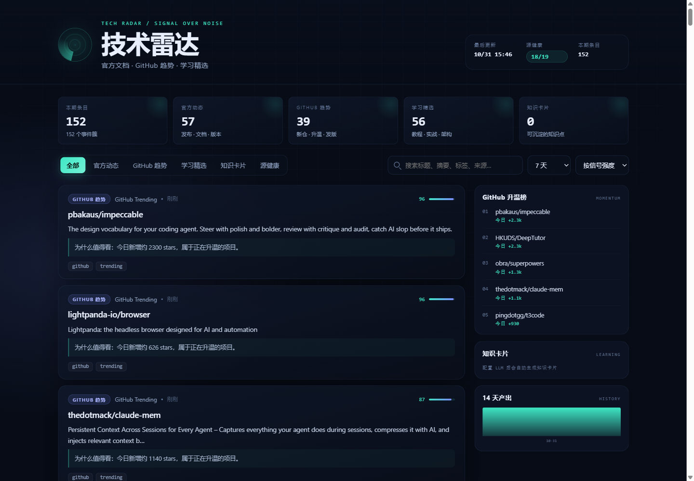

# 技术雷达 Tech Radar

把 **官方文档 / Release Notes、GitHub 趋势、高质量学习站** 收敛成一张每天可看的网页仪表盘。

- 官方源优先，GitHub 次之，学习站再次
- 自动去重、按信号强度排序、按来源做多样性衰减
- LLM 可选：有 key 生成摘要 + 知识卡片，没 key 自动降级为规则摘要
- 纯静态站：采集跑 GitHub Actions，页面部署 GitHub Pages，零服务器



---

## 数据源（v1，19 个）

| 层级 | 来源 | 入口 | 抓取方式 |
|---|---|---|---|
| 官方 | Claude Code Releases | `github.com/anthropics/claude-code/releases.atom` | Atom |
| 官方 | Anthropic News | `anthropic.com/news` | 页面指纹监控 |
| 官方 | OpenAI News | `openai.com/news/rss.xml` | RSS |
| 官方 | GitHub Changelog | `github.blog/changelog/feed/` | RSS |
| 官方 | GitHub Blog | `github.blog/feed/` | RSS |
| 官方 | MCP Releases | `github.com/modelcontextprotocol/modelcontextprotocol/releases.atom` | Atom |
| 官方 | LangChain4j Releases | `github.com/langchain4j/langchain4j/releases.atom` | Atom |
| 官方 | Spring Blog | `spring.io/blog.atom` | Atom |
| 官方 | DeepSeek News | `api-docs.deepseek.com/news` | 页面指纹监控 |
| 官方 | 火山方舟 Docs | `docs.volcengine.com/docs/ark` | 页面指纹监控 |
| GitHub | GitHub Trending | `github.com/trending?since=daily` | 页面解析 |
| GitHub | GitHub New Repos | Search API：`created:>{7d} topic:...` | API |
| GitHub | Watchlist Releases | 8 个关注仓库的 releases | API |
| 学习 | Simon Willison | `simonwillison.net/atom/everything/` | Atom |
| 学习 | 美团技术团队 | `tech.meituan.com/rss.xml` | RSS |
| 学习 | Baeldung | `baeldung.com/feed` | RSS |
| 学习 | JavaGuide | `javaguide.cn/rss.xml` | RSS |
| 学习 | InfoQ 中文 | `infoq.cn/feed` | RSS |
| 学习 | HelloGitHub | `hellogithub.com/rss` | RSS |

> 源清单是可审计的：`config/sources.json` 里每个源都有 `tier`、`weight`、`type`、`enabled`。

---

## 架构

```
GitHub Actions（每 2 小时）
  └─ radar.run
       ├─ fetch      RSS/Atom · GitHub API · Trending · 页面指纹
       ├─ dedupe     URL / 标题相似度 / 版本号保护 / 同仓库合并
       ├─ score      来源权重 + 时效衰减 + 动量 + 学习价值 + 来源多样性
       ├─ summarize  DeepSeek / 火山方舟（可选）→ 摘要 + 知识卡片
       ├─ store      data/items.json + data/history/*.json
       └─ build      web/ + data → public/
  └─ upload-pages-artifact → GitHub Pages
```

本地也可以完整跑通：`python -m radar run`。

---

## 快速开始

```bash
cd D:\projects\tech-radar
python -m pip install -r requirements.txt -r requirements-dev.txt
python -m pytest -q
```

### 先看界面（不用联网、不用 key）

```bash
python -m radar demo
python -m radar serve --port 8787
```

打开 <http://127.0.0.1:8787>。演示数据会显示黄色提示条。

### 跑真实数据

```bash
python -m radar run
python -m radar serve --port 8787
```

只检查源健康、不生成页面：

```bash
python -m radar check
```

### 导出到 Obsidian 知识库

```bash
python -m radar export
```

默认写入：

```
D:\mdStudy\personal-knowledge-base\AI\04-资料库\AI工具雷达\YYYY-MM-DD-技术雷达.md
```

自定义目录：

```bash
python -m radar export --dir "D:\你的\目录"
```

导出文件用 `<!-- tech-radar:start/end -->` 标记自动生成区；你在标记外手写的内容不会被覆盖，重复运行只替换标记内的部分。

只跑部分源（本地网络调试用）：

```bash
python -m radar run --only openai_news,github_changelog,simon_willison
```

---

## LLM 配置（可选）

不配置也能跑：摘要降级为原始摘要，知识卡片为空。

### DeepSeek

```powershell
# PowerShell
$env:DEEPSEEK_API_KEY="sk-..."
$env:LLM_PROVIDER="deepseek"
python -m radar run
```

```bash
# bash
export DEEPSEEK_API_KEY=sk-...
export LLM_PROVIDER=deepseek
python -m radar run
```

### 火山方舟

```powershell
$env:LLM_PROVIDER="ark"
$env:ARK_API_KEY="..."
$env:ARK_MODEL="<你的推理接入点 ID>"
python -m radar run
```

> 火山方舟的 `ARK_MODEL` 必须是控制台里的推理接入点 ID，代码不硬编码具体模型名。

成本控制：只对 `score >= llm.min_score` 的前 `llm.max_items` 条调用，默认 30 条/次；同一条内容有缓存，不会重复付费。

---

## 部署到 GitHub Pages

1. 新建 GitHub 仓库并推送本项目。
2. 仓库 **Settings → Pages → Build and deployment → Source** 选择 **GitHub Actions**。
3. 可选：**Settings → Secrets and variables → Actions** 添加 `DEEPSEEK_API_KEY`。
4. 手动运行一次 `tech-radar` workflow，或 push 到 `main`。

注意：

- GitHub Pages 对公开仓库免费；私有仓库需要付费计划。
- workflow 每 2 小时跑一次，GitHub 免费计划可能有延迟。
- runner 是无状态的，`data/state` 和 `data/history` 用 `actions/cache` 持久化；缓存 7 天不访问会被清理，但每 2 小时运行不会触发。
- 首次运行后，`html_monitor` 源只记录页面指纹（`baseline`），第二次检测到变化才产出条目。

---

## 配置说明

`config/sources.json` 顶层：

| 字段 | 含义 |
|---|---|
| `window_hours` | 只保留最近 N 小时的条目，默认 720（30 天）；界面默认只看 7 天 |
| `max_items_per_source` | 每个 feed 最多取多少条 |
| `scoring` | 来源 / 时效 / 动量 / 学习价值权重，以及时效半衰期 |
| `diversity` | 同一来源前 N 条不衰减，之后按 `decay` 衰减，避免一个博客刷屏 |
| `llm` | provider、模型、最大分析条数、最低分、批大小 |

单个源：

```json
{
  "id": "example_blog",
  "name": "Example Blog",
  "tier": "learning",
  "type": "feed",
  "url": "https://example.com/feed.xml",
  "weight": 4,
  "tags": ["java", "tutorial"],
  "enabled": true
}
```

支持的 `type`：

| type | 用途 | 关键字段 |
|---|---|---|
| `feed` | RSS / Atom | `url` |
| `github_search` | 新仓搜索 | `queries`，支持 `{date_7d}` 占位符 |
| `github_trending` | GitHub Trending 页面 | `url` |
| `github_watchlist` | 关注仓库 releases | `repos` |
| `html_monitor` | 官方文档/公告页变更 | `url`，首次只记录指纹 |

### 加源前的质量审核

按这五项打分（1-5），总分低于 15 不建议进默认视图：

| 维度 | 判断标准 |
|---|---|
| 权威性 | 官方 / 一手作者 > 二手媒体 |
| 信噪比 | 开发相关内容占比高，不靠标题党 |
| 稳定性 | 有 RSS/Atom/API，页面结构稳定 |
| 学习价值 | 能学到方法、原理或可复用的实践 |
| 时效性 | 有时间戳，更新频率明确 |

默认拒绝：需要登录/验证码、反爬严格、无时间戳、内容以娱乐/情绪为主、来源不明的聚合站。

---

## 目录结构

```
tech-radar/
├── config/sources.json        # 源清单 + 评分/LLM 配置
├── radar/
│   ├── fetch.py               # 各类抓取器
│   ├── dedupe.py              # 事件聚类
│   ├── score.py               # 评分 + 多样性 + star 历史
│   ├── summarize.py           # LLM + fallback + 缓存
│   ├── store.py               # JSON 落盘 + 静态站构建
│   └── cli.py                 # run / build / serve / check / demo
├── web/                       # 无框架静态仪表盘
├── fixtures/demo_items.json   # 演示数据
├── tests/                     # 单元测试
├── data/                      # 运行时生成（gitignore）
├── public/                    # 构建产物（gitignore）
└── .github/workflows/radar.yml
```

---

## 已知限制

- **本机网络**：当前 Windows 环境访问 `github.com` 原始页面、`huggingface.co`、`docs.claude.com` 会超时；`api.github.com` 正常。正式采集请跑 GitHub Actions。
- **GitHub Trending** 没有官方 API，页面解析可能随 GitHub 改版失效；`check` 和源健康页会报错。
- **OpenAI changelog** 对脚本返回 403，因此用 OpenAI News RSS 替代。
- **Anthropic News** 没有稳定 feed，用页面指纹监控兜底；主要信号仍以 Claude Code Releases 为准。
- 只保存标题、摘要、链接，不转载全文；引用请回源。
- 不复制 GPL/AGPL 项目代码；本项目只通过公开 RSS/API 消费数据。
- LLM 不可用时知识卡片为空，这是预期降级，不是故障。
- 某个源临时失败（超时/403）时，上一轮该源的条目会缓存续用，卡片标「缓存」；数据不是本次新抓的，源健康页仍显示 error。

---

## 验证记录（2026-10-31）

- `python -m pytest -q` → **23 passed**
- 本地真实采集（19 个源，多次运行）→ **130–152 条，14–18/19 源健康**（波动来自本机访问 github.com / anthropic.com 的网络）
- DeepSeek 已接入 → **24 张知识卡片，1 次新调用 + 29 次缓存命中，0 报错**；未命中 LLM 的条目自动降级
- Obsidian 导出 → `AI\04-资料库\AI工具雷达\2026-10-31-技术雷达.md`（23KB，含知识卡片、三层条目、源健康）
- 演示数据 → **11 条，4 张知识卡片**
- 仪表盘 tabs、搜索、时间筛选、源健康页已用浏览器实测
- 单个源临时失败时，上一轮条目会**缓存续用**并在卡片上标注「缓存」，健康页仍显示 error

---

## Roadmap

- ✅ 知识卡片导出到 `D:\mdStudy\personal-knowledge-base\AI\04-资料库\AI工具雷达\`（`python -m radar export`）
- Phase 2：把采集/分析改写成 Java 21 + Spring Boot + Spring AI（复用同一套静态前端）
- Phase 3：历史趋势页、按主题的雷达图、企业微信/飞书推送
